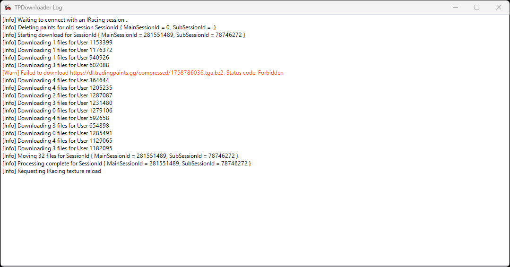

# TPDownloader


An open source alternative [Trading Paints](https://www.tradingpaints.com/) downloader for IRacing.

## Usage
1. Go to the [latest release](https://github.com/DalySoftware/TPDownloader/releases/latest).
2. Download `TPDownloader.exe` from the Assets section.
3. Place it anywhere on your computer.
4. Start `TPDownloader.exe`.

You're all set! TPDownloader will monitor for any IRacing session that you join and download the relevant paints.

The program starts minimized in the system tray by default. To view logs, right click the tray icon and select "Show".

To run TPDownloader automatically when Windows starts, open `Settings > Proxy Settings...` and enable `Run TPDownloader when Windows starts`.

## Features
- Downloads, unpacks and saves all paint types
- Triggers IRacing to refresh paints after finishing downloads
- Cleans up anything it downloaded when the session is left or TPDownloader is exited
- Optional proxy support for Trading Paints requests
- Optional SSH tunnel mode for routing Trading Paints requests through a VPS
- Built-in proxy test for Trading Paints domains

No other major features are planned. The intention is to keep this program minimalist so that you can reasonably review it before running on your system.

## Proxy

TPDownloader can route Trading Paints network requests through a proxy. This affects the Trading Paints fetch endpoints and downloaded paint files only; the iRacing SDK connection is local and does not use the proxy.

Open `Settings > Proxy Settings...` from the log window, or right-click the TPDownloader tray icon and select `Proxy Settings...`.

The proxy settings window supports:

- Proxy URL
- Proxy username
- Proxy password
- Bypass proxy for local addresses
- SSH tunnel mode
- Windows autostart
- Testing current settings against Trading Paints domains

Save the settings, then restart TPDownloader for network changes to apply.

Create an `appsettings.json` file next to `TPDownloader.exe` for manual configuration:

```json
{
  "Proxy": {
    "Url": "http://127.0.0.1:7890",
    "BypassOnLocal": true
  }
}
```

You can also set the proxy URL with an environment variable:

```powershell
$env:TPDOWNLOADER_PROXY = "http://127.0.0.1:7890"
```

For proxies that require authentication, add `Username` and `Password` under `Proxy`.

## SSH Tunnel Proxy

TPDownloader can start a local SOCKS proxy through `ssh.exe`. This lets you route Trading Paints traffic through a VPS without running Squid or another public proxy service on the server.

Open `Settings > Proxy Settings...`, enable `Use SSH tunnel`, and fill in:

- `SSH host`: your VPS hostname or IP address
- `SSH port`: usually `22`
- `SSH username`: for example `root`
- `Local SOCKS port`: usually `7890`
- `SSH key file`: optional private key path

When this mode is enabled, TPDownloader starts:

```powershell
ssh.exe -N -D 127.0.0.1:7890 user@host
```

and uses `socks5://127.0.0.1:7890` for Trading Paints HTTP requests.

The SSH tunnel is started in batch mode, so key-based SSH access or an already configured SSH agent is required. Accept the VPS host key once from a normal terminal before using this mode:

```powershell
ssh user@host
```

## Proxy Test

Use the `Test` button in `Settings > Proxy Settings...` to check the current proxy or SSH tunnel settings before saving.

The test checks these Trading Paints domains:

- `dl.tradingpaints.com`
- `dl1.tradingpaints.gg`
- `dl2.tradingpaints.gg`
- `fetch.tradingpaints.gg`
- `showroom-assets.tradingpaints.gg`
- `update.tradingpaints.gg`

## Disclaimer
No affiliation with Trading Paints. Provided as-is with no warranty of any kind.
